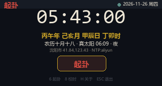
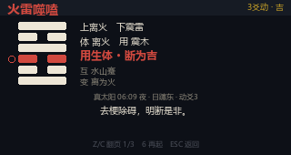
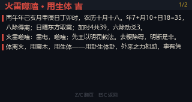

# 起卦 · Qigua

CardputerZero 上的**时空梅花易数**小应用。打开是一只校过时的数字钟，下面挂着农历与干支四柱；
按 **6** 键即以**当下这一刻**起卦，并给出卦象与解释。

| 时钟页 | 卦象页 |
|---|---|
|  |  |
| **断语页** | **关于页** |
|  |  |

## 起卦规则

「时」与「空」各出一半，界面会把算式原样打出来，可自行复算：

| 项 | 取值 | 说明 |
|---|---|---|
| 年数 | 年支序（子1…亥12） | 干支历，**立春**换年 |
| 月数 | 农历月 | 定朔定气 |
| 日数 | 农历日 | 定朔定气 |
| 时数 | 时辰序（子1…亥12） | **真太阳时** = 时钟 + 经度修正 + 均时差 |
| 上卦 | (年+月+日) mod 8，0 作 8 | 时间 |
| 下卦 | 日躔方位所属**后天八卦** | 空间：由经纬度与时刻算出的太阳方位角 |
| 动爻 | (年+月+日+时) mod 6，0 作 6 | 时间 |

断法照梅花易数本门：动爻所在之卦为「用」、另一卦为「体」，以体用五行生克定吉凶
（用生体 / 比和 / 体克用 / 体生用 / 用克体），互卦看中间过程，变卦看最终结果，再叠一句昼夜时气。

因为经度进了「真太阳时」、太阳方位进了「下卦」，同一时刻在不同地点会得到不同的卦。

## 历法

`src/astro.py` 自算，不依赖 lunardate / ephem 之类的库：

- 太阳视黄经、赤经赤纬、均时差、高度角与方位角（Meeus 低精度公式）
- 二十四节气：在展开后的黄经上找 15° 整数倍的过零时刻，二分到秒级
- 朔：Meeus 第 49 章新月公式（误差约 1 分钟）
- 中国农历：定朔定气 + **无中气置闰**，日界按 UTC+8
- 干支四柱：年柱立春换、月柱节气换（五虎遁）、日柱 23 时换、时柱五鼠遁

`tests/test_astro.py` 的基准用例：

```
2026-11-26 04:44 (CST) → 丙午年 己亥月 甲辰日 丙寅时，农历十月十八
```

同时校验 2024/2025/2026 三年春节（2-10 / 1-29 / 2-17）、2025 年闰六月、均时差极值与节气序。

## 校时与定位

- **校时**：SNTP（UDP 123，`ntp.aliyun.com` → `cn.pool.ntp.org` → … 逐个试），
  失败退到 HTTP `Date` 头，再不行用本机 RTC；启动即校时，之后每 30 分钟一次。
  顶栏圆点：青 = 已用 NTP 对齐、金 = HTTP、灰 = 本机 RTC。
- **定位**：`ip-api.com?lang=zh-CN`（中文地名）→ `ipwho.is` → `ipapi.co` → `ipinfo`，
  结果缓存 30 分钟；全部失败则退回「标准经线」模式（经度 = 时区×15°），界面会标出。
- 需要固定坐标时写 `~/.config/qigua/config.json`：

  ```json
  {"lat": 30.5728, "lon": 104.0668, "city": "成都", "tz": 8}
  ```

## 按键

屏幕正对下方数字键 4\~8（官方《推荐按键设计》），**6 键对应屏内 x=161**，【起卦】按钮即固定在此。
非文本输入状态可直接用 `F`/`Z`/`X`/`C` 当方向键，不必按住 fn。

| 屏幕 | 键 | 作用 |
|---|---|---|
| 时钟 | `6` / `Enter` / `空格` | 起卦（以按下这一刻为准） |
| 时钟 | `8` | 重新校时 + 重新定位（跳过缓存，回执显示在页脚） |
| 时钟 | `H` | 关于页 |
| 时钟 | `ESC` / `Backspace` | 退出，回桌面 |
| 时钟 | `A` / `D` | 微调按钮横坐标（±4px，存入配置） |
| 卦象 / 断语 | `C` / `X`、`Z` / `F` | 翻页（方向键亦可） |
| 卦象 / 断语 | `6` / `Enter` | 重新起卦 |
| 卦象 / 断语 | `ESC` | 第一页回时钟，后续页回卦象页 |
| 关于 | `H` / `ESC` / `6` | 回时钟 |

任何按键都会在左下角闪一个青点，便于确认输入是否到达。

## 安装

```bash
python build_deb.py                            # → dist/qigua_<version>_all.deb
sudo apt install -y --reinstall ./dist/qigua_*.deb
systemctl --user restart APPLaunch             # 让 launcher 重读菜单
```

装完 launcher 里会出现「起卦」图标（`/usr/share/APPLaunch/applications/qigua.desktop`，
`Sysplause=true`，退出后自动回桌面）。

`.deb` 是纯 Python、`Architecture: all`，打包脚本用标准库直接写 ar 归档，
所以在 Windows 上也能出包，不需要交叉编译工具链。

## 开发

```bash
python src/main.py --screenshot shots/clock.png \
    --at "2026-11-25 20:44:17" --tz 8 --lat 30.5728 --lon 104.0668 --city 成都 --cast
```

不需要设备，直接输出 320×170 的 PNG（时钟页 + 卦象页 + 断语页），用于调版式。

```bash
python tests/test_astro.py      # 历法
python tests/test_gua.py        # 术法
python tools/make_store_assets.py   # 图标 + 四张商店截图
python tools/check_store.py         # 元数据与包结构自检
```

| 路径 | 内容 |
|---|---|
| `src/astro.py` | 太阳位置、节气、朔、农历、干支 |
| `src/gua.py` | 八卦 / 六十四卦数据、起卦、体用生克、断语生成 |
| `src/net.py` | SNTP 校时、IP 定位、配置与缓存 |
| `src/cz.py` | framebuffer 与 evdev 键盘、字体 |
| `src/ui.py` | 时钟页 / 卦象页 / 断语页 / 关于页 |
| `src/main.py` | 状态机、按键、后台校时线程 |

## 已知边界

- 农历日界固定按 UTC+8（1929 年以后中国历书基准），设备时区变化不会改日界。
- ΔT 用分段近似（2026 年约 69 秒），朔与节气可能有 ±1 分钟误差，
  极少数「交节或朔日恰好跨零点」的日期会差一天。
- 定位靠 IP，机房或代理出口可能指到别的城市；需要准确坐标请写配置文件。

## 许可

MIT，见 [LICENSE](LICENSE)。

出品：[fiddling科技工作室](https://fiddling.work)
